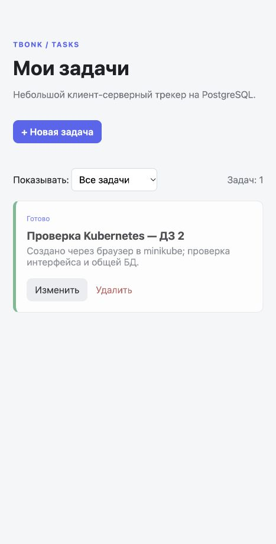

# ДЗ‑2. Tbonk Tasks в minikube

## Что развёртывается

| Абстракция | Объект | Назначение |
|---|---|---|
| Namespace | `tbonk` | Отдельное пространство имён приложения |
| Deployment | `tbonk`, 2 реплики | Восстанавливает и обновляет stateless веб-поды |
| Service | `tbonk:8000`, ClusterIP | Постоянный адрес приложения внутри кластера |
| StatefulSet | `postgres`, 1 реплика | Стабильное имя БД и привязка к диску |
| Headless Service | `postgres:5432` | DNS для PostgreSQL и управляющий Service StatefulSet |
| PVC | `data-postgres-0`, 1 GiB | Данные БД переживают пересоздание пода |
| ConfigMap | `tbonk-config` | Порт и несекретные параметры подключения |
| Secret | `tbonk-db` | Учебный пароль для сервера и клиента PostgreSQL |
| Job | `tbonk-init-db` | Одноразовое создание схемы перед веб-приложением |

Схема взаимодействия: браузер → локальный `port-forward` → веб-под → DNS `postgres` → PostgreSQL. Все веб-реплики используют одну базу; локальных пользовательских сессий в памяти нет. В обычном внутрикластерном обращении Service балансирует между готовыми подами. `port-forward service/...` выбирает конкретный под и сам по себе не демонстрирует балансировку.

`/live` отвечает без обращения к БД. `/health` выполняет запрос к таблице `tasks`: если БД недоступна или схема ещё не создана, readiness не пропускает трафик. Startup probe даёт процессу время запуститься.

## Запуск с Docker

На macOS нужен работающий Docker Desktop/совместимая Linux VM: инструкция Docker Engine для Linux не является инструкцией установки на macOS. Установить `minikube`, `kubectl` и Helm можно пакетным менеджером. Не подменяйте Docker CLI ссылкой на Podman для команды `docker-env`: это разные клиенты.

```bash
minikube start -p tbonk-homework --driver=docker --container-runtime=docker --kubernetes-version=v1.34.1 --cpus=4 --memory=6144
eval "$(minikube -p tbonk-homework docker-env)"
docker build -t tbonk-tasks:hw2 .
# При сборке в minikube daemon образ уже находится в кластере.
minikube -p tbonk-homework image ls | grep tbonk-tasks
bash scripts/deploy-app.sh
kubectl --context tbonk-homework -n tbonk port-forward svc/tbonk 8000:8000
```

Открыть http://localhost:8000. Если требуется именно отдельный шаг загрузки из задания, используйте другой способ сборки в daemon хоста:

```bash
eval "$(minikube -p tbonk-homework docker-env -u)"
docker build -t tbonk-tasks:hw2 .
minikube -p tbonk-homework image load tbonk-tasks:hw2
bash scripts/deploy-app.sh
```

`docker-env` и `image load` — два способа доставки образа; после сборки непосредственно внутри minikube отдельная загрузка из хоста не нужна. В манифестах задан `imagePullPolicy: Never`, чтобы локальный учебный образ не искался в публичном registry.

Альтернатива для установленного rootful Podman, как на этой машине: запустить его VM, создать minikube с `--driver=podman --container-runtime=cri-o --kubernetes-version=v1.34.1`, собрать образ через `podman build -t docker.io/library/tbonk-tasks:hw2 .`, сохранить через `podman save -o /tmp/tbonk-hw2.tar docker.io/library/tbonk-tasks:hw2`, затем `minikube -p tbonk-homework image load /tmp/tbonk-hw2.tar`. Полное имя образа важно: короткое имя манифеста разрешается через docker.io/library, а Podman по умолчанию может записать тег под localhost. Этот временный tar нужен только для доставки образа, не для сдачи домашки. Драйвер Podman экспериментальный.

## Команды для демонстрации (до 7 минут)

1. Показать `k8s/app/`, Dockerfile и `kubectl --context tbonk-homework get nodes`.
2. Запустить `bash scripts/deploy-app.sh`, пояснить порядок БД → Job → веб.
3. Выполнить `kubectl --context tbonk-homework -n tbonk get pods,svc,pvc,jobs`.
4. `kubectl --context tbonk-homework -n tbonk scale deployment/tbonk --replicas=3`.
5. `kubectl --context tbonk-homework -n tbonk rollout status deployment/tbonk`, снова показать поды.
6. Пробросить Service на 8000, создать задачу, отредактировать статус, отфильтровать готовые и удалить задачу.
7. Вернуть 2 реплики: `kubectl --context tbonk-homework -n tbonk scale deployment/tbonk --replicas=2`.

Не масштабировать обычный PostgreSQL StatefulSet до 3: три независимые БД не становятся автоматически реплицируемой БД.

## Ограничения

Один узел minikube, один PostgreSQL, локальное хранилище и учебный пароль. Secret в YAML не обеспечивает шифрование исходного файла. Это учебная конфигурация, не production HA. Демонстрационные скринкасты не создаются автоматически; сценарий выше предназначен для реальной записи.

## Фактическая проверка 8 ноября 2026

Именно версия ДЗ‑2 развёрнута в отдельном minikube-профиле: Job завершился, PVC подключён, веб масштабирован до трёх реплик. Через UI создана задача и изменён её статус. [Вывод kubectl](../evidence/hw2-kubernetes.txt).



## Источники

- [Доставка образов в minikube](https://minikube.sigs.k8s.io/docs/handbook/pushing/)
- [Драйвер Podman](https://minikube.sigs.k8s.io/docs/drivers/podman/)
- [Установка Docker](https://docs.docker.com/engine/install/)
