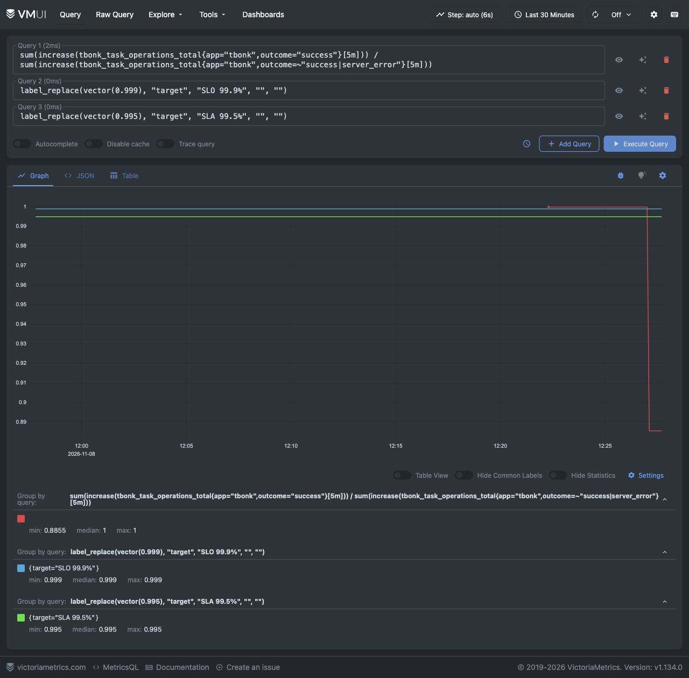
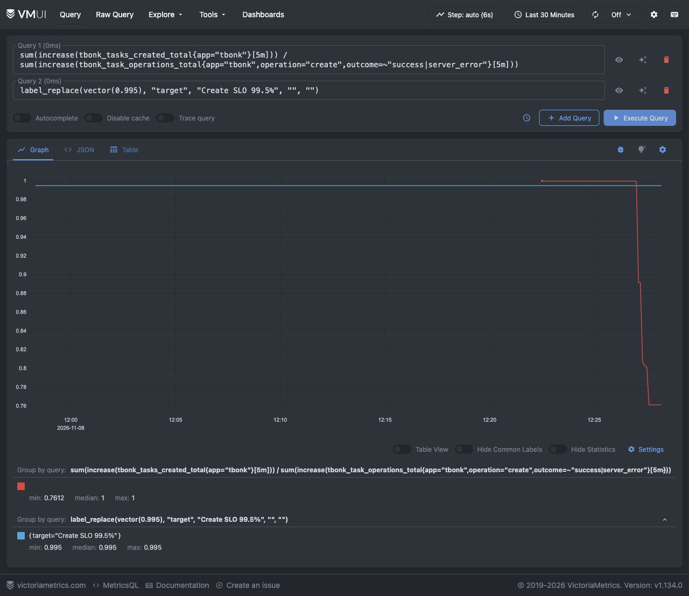
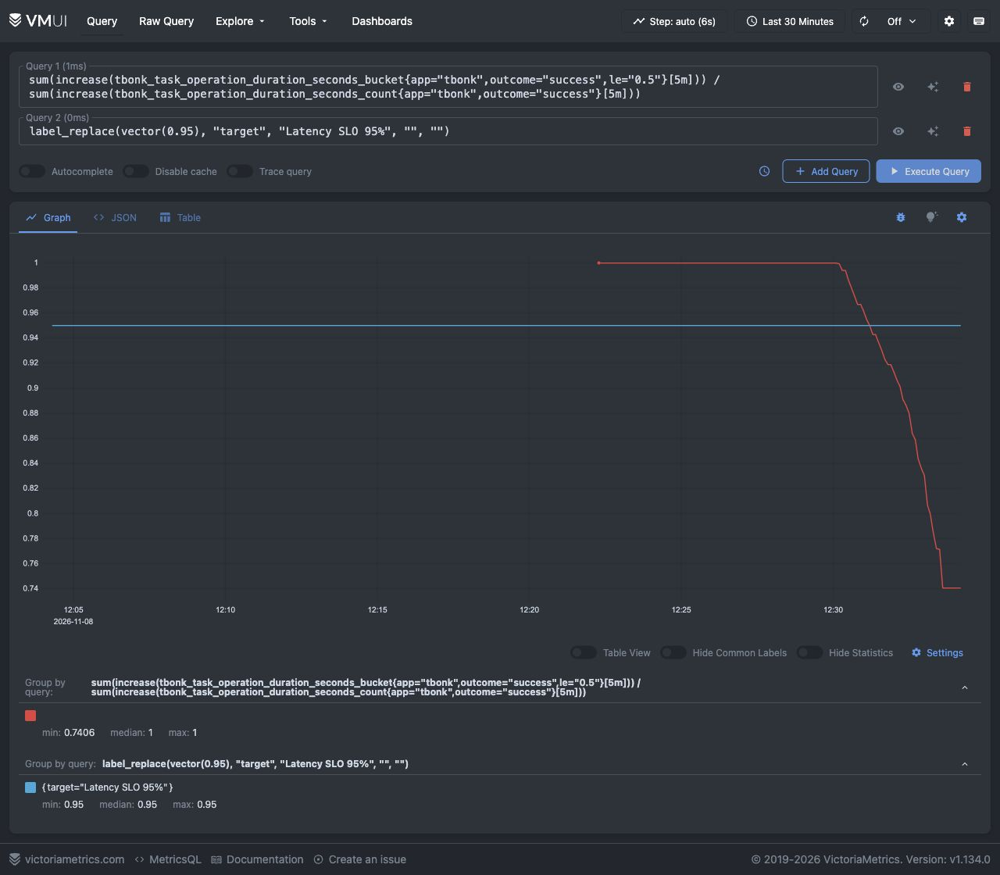

# ДЗ‑5. SLI, SLO, SLA и пользовательский пробер

## Соответствие терминов

| Определение | Термин |
|---|---|
| Подход к выбору метрик для сервисов, обрабатывающих запросы | RED: Rate, Errors, Duration |
| Внешнее соглашение с бизнесом/клиентами об уровне сервиса | SLA |
| Допустимая недоступность за период | Бюджет ошибок (в общем случае также доля/число неуспешных операций) |
| Количественный индикатор пользовательского опыта за период | SLI |
| Целевое значение индикатора | SLO |
| Подход к метрикам аппаратного и системного уровня | USE: Utilization, Saturation, Errors |
| Синтетический тест пользовательских действий | Пробер |

## Метод и границы измерения

Используется RBSLO — отношение хороших операций к допустимым попыткам. Основной период оценки — скользящие 30 суток. Для короткой демонстрации используются окна 5 минут; выполнение цели на 5 минутах не доказывает выполнение месячного SLO.

Допустимая попытка API: запрос к известной операции list/read/create/update/delete, завершившийся успехом или 5xx. 400/404 относятся к client_error и исключены из знаменателя. Это определение нужно согласовывать заранее: пользовательская ошибка ввода не считается недоступностью сервиса. Запросы, не достигшие процесса, приложение не посчитает — их влияние дополнительно проверяет синтетический пробер.

## Индикаторы и цели

Обозначим ΔX как прирост counter за окно с учётом рестартов, суммированный по подам. Во всех запросах используется `sum(increase(...))`, а не `increase(sum(...))`.

| SLI | Метрики из ДЗ‑4 | Формула | SLO за 30 дней |
|---|---|---|---|
| Доступность API | `tbonk_task_operations_total` | успешные / (успешные + server_error) | ≥99.9% |
| Скорость API | `tbonk_task_operation_duration_seconds_bucket` и `_count` | успешные ≤500 мс / все успешные | ≥95% |
| Успешность создания | `tbonk_tasks_created_total` и attempts в `tbonk_task_operations_total` | закоммиченные создания / допустимые попытки create | ≥99.5% |
| Синтетический сценарий | новый `tbonk_probe_runs_total` | успешные полные CRUD-сценарии / все завершённые прогоны | ≥99.9% |

Таким образом, первые три индикатора используют как минимум три семейства метрик, реализованных в предыдущем ДЗ. Пробер — дополнительная независимая проверка.

Если в окне нет подходящих операций, знаменатель равен нулю: результат неопределён, это «нет данных», а не 100% и не 0%. Мы намеренно не добавляем `or vector(1)` и не подменяем знаменатель единицей. Исчезновение самого сборщика и пробера должно контролироваться отдельными алертами, а не интерпретироваться как успех.

## Формулы для vmui

Готовые строки лежат в `queries.json`. Для месячного расчёта заменить `[5m]` на `[30d]` и иметь полную историю за период. В этой ветке `server.retentionPeriod` увеличен с 7 до 31 дня; обновить Helm-релиз через `bash scripts/deploy-metrics.sh`. Увеличение retention не создаёт историю задним числом. Учебные графики используют 5 минут.

Доступность:

```promql
sum(increase(tbonk_task_operations_total{app="tbonk",outcome="success"}[5m]))
/
sum(increase(tbonk_task_operations_total{app="tbonk",outcome=~"success|server_error"}[5m]))
```

Доля быстрых успешных операций:

```promql
sum(increase(tbonk_task_operation_duration_seconds_bucket{app="tbonk",outcome="success",le="0.5"}[5m]))
/
sum(increase(tbonk_task_operation_duration_seconds_count{app="tbonk",outcome="success"}[5m]))
```

Успешность создания:

```promql
sum(increase(tbonk_tasks_created_total{app="tbonk"}[5m]))
/
sum(increase(tbonk_task_operations_total{app="tbonk",operation="create",outcome=~"success|server_error"}[5m]))
```

Успешность полного сценария:

```promql
sum(increase(tbonk_probe_runs_total{app="tbonk-prober",outcome="success"}[5m]))
/
sum(increase(tbonk_probe_runs_total{app="tbonk-prober"}[5m]))
```

Значения находятся в диапазоне 0..1. Для процентов умножить на 100. Для каждого графика добавить второй запрос `vector(0.999)`, `vector(0.95)` или `vector(0.995)` соответственно — это линия SLO. SLA для доступности отобразить третьей линией `vector(0.995)`.

SLO и SLA — фиксированные цели, а не метрики, которые должны падать вместе с сервисом. Меняются наблюдаемый SLI, признак соблюдения цели и расход бюджета ошибок. Для признака соблюдения SLO можно использовать `(выражение_SLI) >= bool 0.999`; для доли использованного бюджета — `(1 - выражение_SLI) / (1 - 0.999)`. Значение больше 1 означает превышение бюджета в выбранном окне.

## Учебная формулировка SLA

Пример внешнего соглашения для этого учебного приложения: «За скользящие 30 суток не менее 99.5% допустимых API-операций завершаются успешно по определению доступности выше. При нарушении команда фиксирует инцидент, предоставляет разбор причин и план исправления; в условной платной версии предусмотрен кредит 5% месячной стоимости». Это проект формулировки для задания, а не реально действующий договор.

Внутренний SLO доступности 99.9% строже SLA 99.5%: команда реагирует раньше договорного порога. SLO скорости и создания — дополнительные внутренние цели; общий искусственный SLA путём умножения всех процентов не вводится. Эти события зависимы, и такое умножение не обосновано.

Для RBSLO бюджет = N × (1 − SLO). При 100000 допустимых операций и SLO 99.9% разрешено 100 неуспешных. Для TBSLO аналогичный процент на 30 сутках означал бы 43.2 плохих минуты; это другой знаменатель, нельзя выдавать request-based расчёт за измеренное время простоя.

## Пробер

Отдельный Deployment `tbonk-prober` в namespace monitoring запускает `python -m backend.prober` из того же образа. Каждые примерно 15 секунд он создаёт уникальную учебную задачу, читает и проверяет title, обновляет до done, проверяет результат и удаляет. Тайм-аут каждого HTTP-вызова — 5 секунд. При сбое выполняется best-effort удаление только созданной этим прогоном задачи. При сетевом обрыве до получения id задача может остаться: для production нужны идемпотентность и отдельная синтетическая учётная запись/tenant.

На 9115 экспортируются последнее состояние, число success/failure, длительность и timestamp последнего завершённого прогона. Discovery из ДЗ‑4 автоматически обнаруживает pod по аннотациям.

Пробер выполняет настоящие записи и потому тоже увеличивает бизнес-счётчики. Для учебного стенда это намеренно. Пользовательский и синтетический трафик в SLI здесь не разделены; при реальном использовании их нужно размечать ограниченным label и строить отдельные показатели. Пробер внутри того же кластера проверяет API+БД, но не внешний DNS/TLS/Ingress и не падение всего кластера.

## Изменение поведения и демонстрация

Собрать и загрузить `tbonk-tasks:hw5`; обновить приложение и применить пробер:

```bash
bash scripts/deploy-app.sh
kubectl --context tbonk-homework apply -f k8s/slo/prober.yaml
kubectl --context tbonk-homework -n monitoring rollout status deployment/tbonk-prober
```

Пробросить приложение на 8000, VictoriaMetrics на 8428. Открыть http://localhost:8428/vmui/ и построить четыре графика с линиями целей.

После каждого `demo-mode.sh` происходит rollout: `port-forward svc/tbonk` привязан к конкретному pod и может завершиться вместе с ним. Перед следующим запуском `scripts/load.py` заново запустите проброс приложения. Проброс VictoriaMetrics не затрагивается. Пробер внутри кластера продолжает использовать Service и не зависит от этого локального туннеля.

1. Норма: `python scripts/load.py --seconds 120`; после нескольких scrape-интервалов индикаторы близки к 1.
2. Задержка: `bash scripts/demo-mode.sh latency`, затем ещё 120 секунд нагрузки. Каждый API-вызов задерживается на 0.8 секунды; доля быстрее 0.5 секунды падает, доступность может оставаться высокой.
3. Ошибки: `bash scripts/demo-mode.sh errors`, ещё 120 секунд нагрузки. Каждый четвёртый запрос конкретного процесса получает 503; доступность и вероятность успешного полного сценария падают. Это не гарантирует ровно 25% ошибок создания: порядок операций и распределение между подами влияют на конкретный маршрут.
4. Восстановление: `bash scripts/demo-mode.sh off`; снова нагрузка, наблюдать восстановление за окно 5 минут.

Режим по умолчанию выключен. Управляющего публичного HTTP endpoint нет; настройки меняются через Kubernetes и вызывают rollout. Health/metrics не ломаются искусственно, поэтому можно увидеть деградацию пользовательских операций при зелёном `up`. Если задача — показать потерю самой доступности процесса, используйте отдельно остановку реплик с последующим восстановлением.

Запись экрана должна включать изменение поведения, движение SLI и фиксированные пороги SLO/SLA. Наличие формул и сценария не заменяет фактическую демонстрацию; её подтверждения перечисляются отдельно.

## Фактическая демонстрация

8 ноября 2026 режимы ошибок и задержки включены на реальном minikube-стенде, затем выключены. Графики vmui ниже показывают изменение метрик и постоянные линии целей. Окно графиков демонстрационное (5 минут); это не подтверждение месячного SLO. Проверка выполнена на накопительном стенде ДЗ‑6, использующем те же формулы и режимы ДЗ‑5.







Скриншоты сохранены; отдельная видеозапись не делалась.
