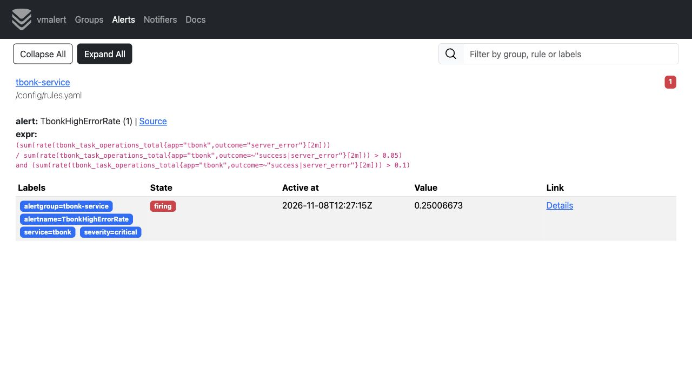
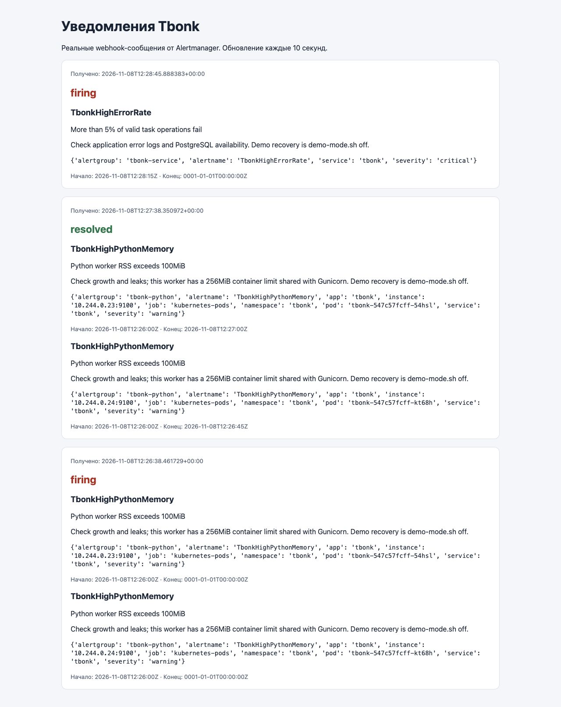

# ДЗ‑6. Алерты сервиса, Python и уведомления

## Схема

VictoriaMetrics собирает метрики → vmalert каждые 15 секунд вычисляет правила → Alertmanager группирует и маршрутизирует уведомления → локальный `alert-inbox` принимает настоящий webhook и показывает его в браузере.

Проверка условия и доставка сообщения — разные функции. Правило может быть firing, но уведомление не прийти из-за неверного receiver, сети или group_wait; поэтому проверяется вся цепочка до inbox. Внешние мессенджеры и почта не подключены, секреты отправки не нужны.

## Выбранные алерты

Полные выражения — `k8s/alerts/rules.yaml`.

| Алерт | Условие | Выдержка | Зачем |
|---|---|---|---|
| TbonkHighErrorRate | >5% server_error среди допустимых операций за 2m и поток >0.1 операции/с | 1m | Значительное ухудшение успешности CRUD |
| TbonkSlowOperations | <95% успешных операций укладываются в 500 мс за 2m; поток успешных >0.1/с | 1m | Нарушение цели задержки из ДЗ‑5 |
| TbonkHighPythonMemory | RSS рабочего Python-процесса >100 MiB | 1m | Рост памяти до приближения к лимиту контейнера 256 MiB |
| TbonkHighPythonCPU | CPU рабочего процесса >0.8 ядра, rate за 2m | 1m | Почти исчерпан лимит контейнера в одно ядро |
| TbonkAppUnavailable | Ни одной доступной scrape-цели приложения или цели отсутствуют | 1m | Полное исчезновение приложения из мониторинга |
| TbonkProbeFailure | Ни одного успешного результата пробера в последнюю минуту | ещё 1m | Постоянный сбой полного пользовательского сценария |
| TbonkProbeMissing | up пробера равен 0/отсутствует либо последний прогон старше 60s | 1m | Не принять остановленный пробер за здоровый сервис |

Первые два — требуемые алерты на метрики сервиса. Следующие два — на реальные метрики Python runtime из стандартного клиента, а не на Kubernetes container usage. Остальные дополняют покрытие отказов и отсутствия данных.

Порог 5% ошибок за 2 минуты выбран для наглядного критического сигнала в небольшом стенде. Он не равен месячному SLO 99.9%; для production правильнее отдельные быстрые/медленные алерты скорости расхода бюджета ошибок. CPU и RSS — показатели одного worker; память master-процесса и всей pod не включена в эти конкретные метрики.

Условия без трафика не должны генерировать процентную тревогу из 0/0. Полная недоступность не теряется: её ловят отсутствие scrape-целей и пробер. Порог минимального трафика уменьшает шум от одной случайной ошибки.

## Alertmanager

Конфигурация — `k8s/alerts/alertmanager.yaml`. Группировка по `alertname`, `service`, `severity`; ожидание первой группы — 10s, обновление группы — 30s, повтор неустранённой проблемы — 1h. Receiver `local-inbox` отправляет POST на `/alerts` внутри кластера, `send_resolved: true` включает сообщения о восстановлении.

Inbox хранит последние 100 уведомлений в памяти и экранирует содержимое при показе HTML. Перезапуск очищает историю; Alertmanager тоже использует временное хранилище. Для учебной демонстрации достаточно, для эксплуатации нужны постоянное хранилище, внешний канал и резервирование. Эти ограничения нельзя путать с долговечностью метрик в PVC VictoriaMetrics.

## Развёртывание

Собрать и загрузить `tbonk-tasks:hw6`, затем выполнить:

```bash
bash scripts/deploy-app.sh
bash scripts/deploy-metrics.sh
kubectl --context tbonk-homework apply -f k8s/slo/prober.yaml
bash scripts/deploy-alerts.sh
```

В разных терминалах:

```bash
kubectl --context tbonk-homework -n monitoring port-forward svc/vmalert 8880:8880
kubectl --context tbonk-homework -n monitoring port-forward svc/alertmanager 9093:9093
kubectl --context tbonk-homework -n monitoring port-forward svc/alert-inbox 8088:8080
kubectl --context tbonk-homework -n monitoring port-forward svc/vm-single 8428:8428
kubectl --context tbonk-homework -n tbonk port-forward svc/tbonk 8000:8000
```

Правила: http://localhost:8880/vmalert/ ; доставка: http://localhost:9093/ ; полученные уведомления: http://localhost:8088/ ; машинная проверка inbox: `/api/notifications`.

## Как воспроизвести срабатывания

Для нагрузки удобнее `bash scripts/load-cluster.sh 180 4`: скрипт запускает ограниченный Job внутри Kubernetes и обращается к Service, поэтому переживает rollout веб-подов. Параметры — секунды и потоки (максимум 3600 и 8). Job автоматически удаляется через 10 минут после завершения. Ниже команды `scripts/load.py` показаны как локальная альтернатива: после каждого rollout заново запустите port-forward приложения, если прежний туннель завершился.

1. Норма: убедиться, что targets доступны, пробер работает, запустить `python scripts/load.py --seconds 120`.
2. Ошибки сервиса: `bash scripts/demo-mode.sh errors`, затем `python scripts/load.py --seconds 180`. Наблюдать pending → firing → уведомление `TbonkHighErrorRate`.
3. Восстановление: `bash scripts/demo-mode.sh off`. Поддерживать нагрузку, подождать выхода плохих samples из окна и получить resolved.
4. Задержки: `bash scripts/demo-mode.sh latency`, запустить нагрузку на 180s, увидеть `TbonkSlowOperations`; затем off.
5. Память Python: `bash scripts/demo-mode.sh memory`. Worker выделяет и касается 128 MiB памяти; RSS становится выше 100 MiB. Через выдержку и group_wait приходит `TbonkHighPythonMemory`. Затем off освобождает память пересозданием подов.
6. CPU Python: `bash scripts/demo-mode.sh cpu`, `python scripts/load.py --seconds 180 --workers 8`. CPU-нагрузка ограничена 0.3 секунды работы на запрос; при достаточном потоке срабатывает `TbonkHighPythonCPU`. Затем off.

Демонстрационные режимы ограничены: задержка ≤5s, CPU ≤0.5s на запрос, память ≤128 MiB. По умолчанию всё выключено; включение доступно через конфигурацию кластера, а не пользовательский HTTP endpoint. Runtime-метрики экспортируются отдельным потоком, поэтому метрики остаются доступными при задержках API.

Нельзя гарантировать срабатывание CPU только командой: оно зависит от реальной нагрузки и ресурсов. Сначала проверить `rate(process_cpu_seconds_total{app="tbonk"}[2m])` и при необходимости дать стенду достаточно трафика. Не снижать порог задним числом только ради красивой картинки.

## Проверки правил и артефакты

`rules.test.yaml` проверяет штатным promtool: ошибочный поток после выдержки, отсутствие преждевременного firing, отсутствие процентного алерта при нулевом трафике, latency-условие, память и CPU. Конфигурация Alertmanager проверяется `amtool check-config`.

```bash
docker run --rm -v "$PWD/k8s/alerts:/config:ro" --entrypoint /bin/promtool \
  prom/prometheus:v3.2.1 test rules /config/rules.test.yaml
docker run --rm -v "$PWD/k8s/alerts:/config:ro" --entrypoint /bin/amtool \
  prom/alertmanager:v0.28.1 check-config /config/alertmanager.yaml
```

8 ноября 2026 на реальном minikube-стенде получены firing и resolved для обоих сервисных алертов (ошибки, задержка) и обоих runtime-алертов (память, CPU). Уведомления действительно отправлены Alertmanager в локальный inbox. Полная история webhook сохранена в [cpu.json](../evidence/cpu.json); этот снимок снят после окончания CPU-нагрузки, поэтому его текущие CPU-значения уже штатные. История уведомлений содержит реальные времена срабатывания.





[Все семь настроенных правил](../evidence/hw6-rules.jpg). [Полная история четырёх срабатываний и восстановления, включая CPU](../evidence/hw6-all-notifications.jpg). Подробности эксперимента — в [журнале проверки](../Проверка.md).

После демонстрации все DEMO-настройки удалены из Deployment, обычные две реплики восстановлены. Принудительные режимы отказа выключены.

## Источники

- [vmalert](https://docs.victoriametrics.com/victoriametrics/vmalert/)
- [Конфигурация Alertmanager](https://prometheus.io/docs/alerting/latest/configuration/)
- [Тестирование правил promtool](https://prometheus.io/docs/prometheus/latest/configuration/unit_testing_rules/)
